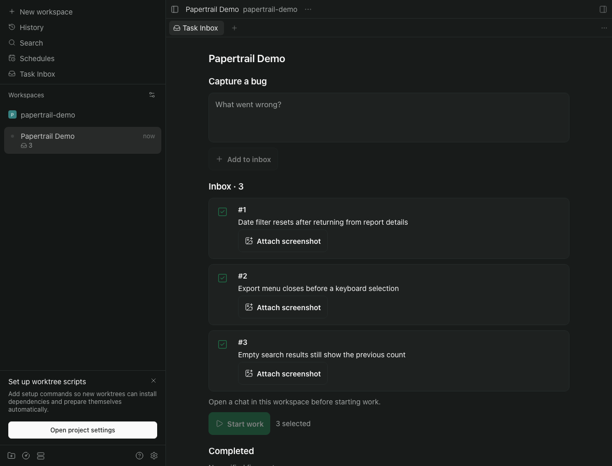

# Paseo Task Inbox

[](https://www.npmjs.com/package/@kelvicthrust/paseo-task-inbox)

Capture bugs and screenshots while you test in Paseo. Send a batch from the workspace’s right-side Explorer to an existing chat or start a new Codex or Claude Code chat. Keep capturing bugs while the agent works, and find verified fixes with links to their pull requests.



## Get started

Use Paseo Desktop 0.17.4 or later and a Paseo daemon with a Node.js runtime that supports `node:sqlite`.

For dispatch and verification, use a workspace with a GitHub `origin`, Codex or Claude Code configured on the host, and Git and an authenticated GitHub CLI (`gh`) on the host.

In Paseo, select that host and turn on **Enable plugins** under **Settings → Plugins**. Paseo plugins are trusted code and run with the daemon user's file and process access. [Paseo plugin setup](https://paseo.sh/docs/plugins)

### Install from the Paseo catalog

Install the catalog-approved version with npm available on the daemon host. [Task Inbox in the Paseo catalog](https://paseo.sh/plugins/kelvicthrust/task-inbox)

```sh
paseo plugin add kelvicthrust/task-inbox
```

In the app, enter `kelvicthrust/task-inbox` as the source under **Settings → Plugins**.

### Install a specific npm version

Use a versioned npm source to test a particular release directly.

```sh
paseo plugin install 'npm:@kelvicthrust/paseo-task-inbox@1.0.1'
```

The sidebar workflow below describes the source checkout. For an older install, use its tagged guide. [Version 1.0.1](https://github.com/kelvicthrust/paseo-task-inbox/blob/v1.0.1/README.md#capture-and-send-bugs) · [Version 0.2.0](https://github.com/kelvicthrust/paseo-task-inbox/blob/v0.2.0/README.md#capture-and-send-bugs)

### Install from source

On the daemon host, use Node.js 26 and npm to install from a checkout.

```sh
git clone https://github.com/kelvicthrust/paseo-task-inbox.git
cd paseo-task-inbox
npm ci --ignore-scripts --include=dev
paseo plugin install "$PWD"
```

### Open Task Inbox

Run `paseo plugin ls task-inbox` and look for **running**. If your daemon uses a custom home, pass `--home /path/to/paseo-home` to the install and status commands. In your workspace, open **+ → Task Inbox** in the right-side Explorer. You can also choose **Open Task Inbox** in the workspace Command Center to open or focus the same tab.

## Capture and send bugs

1. Describe what went wrong. On Desktop or web, add a PNG or JPEG with **Attach**, paste it into the composer, or drop it there. Check the preview, then select **Add task** when the uploads finish.
2. Open a waiting task’s **⋯** menu to make a correction. Choose **Edit task** to update the description or screenshots, then select **Save changes** or **Cancel**. To remove the task and its images, choose **Delete task** from the menu and confirm. Once a batch claims a task, its contents are fixed.

If a screenshot upload fails, select **Retry upload** beside the image or remove it to continue. If Task Inbox can’t confirm a save, select **Retry save** to finish the same request without creating a duplicate.

### Send a batch from Explorer

1. Select the tasks to fix, then check **Send to** in the footer. Task Inbox preselects the only eligible chat. If several are available, choose one by name. Chats with the same name show a short chat ID.
2. Select **Start tasks** to use that chat’s current model and effort. If the chat is busy, select **Queue tasks** to send when it’s ready.
3. Follow the batch in Task Inbox or select **Open chat**. You can keep capturing reports while the batch runs. Switching tabs or reloading returns you to the same batch and chat.

To start a separate chat, choose **Send to → New chat** and pick a model. With no eligible chats, **Send to** opens the model choices directly. If the model supports effort options, choose one under **Effort** or leave it at **Default** to let Paseo resolve it. Switching models resets effort to **Default**. A model saved in **Settings → Plugins → Task Inbox agent** can prefill the new-chat model.

All chats in the workspace share one inbox. Task Inbox allows one active batch per workspace, with up to 20 bugs and 24 MiB of images per batch. Each bug can have up to four images of 8 MiB each.

### Attach screenshots from native mobile

Desktop and web send images through the existing Paseo connection, including when the daemon is remote. Leave the private upload address blank for those clients. On native mobile, save the report first and use its screenshot action to open the private browser uploader. Each link accepts one PNG or JPEG and expires after five minutes. Configure private Tailscale Serve on the daemon host for this path. Check `tailscale serve status` first and choose an unused HTTPS port. For example:

```sh
tailscale serve --bg --https=47831 http://127.0.0.1:47831
```

In **Settings → Plugins → Task Inbox**, open **Screenshot uploads** and save the HTTPS origin printed by Tailscale, including its port. Open the upload link from a device signed into your tailnet under a user account. [Tailscale Serve setup](https://tailscale.com/docs/features/tailscale-serve)

## Verified fixes and blocked batches

Task Inbox finds PRs with matching task markers and fix commits in the workspace repository. It uses the host's `gh` session to follow pushes, merges, and closures. The PR link in Explorer and in the original chat’s results card shows the latest known GitHub status, even when a check is still pending.

**Completed** means the agent reported a passing test or manual check for that bug, and Task Inbox confirmed the matching revision and fix commit on a ready or merged PR. Merging and deploying each require separate authorization.

Task Inbox queues a batch while its chat is busy. Another message can start a turn between the idle check and dispatch. A reconnect reuses the original dispatch ID. If a daemon restart restores chat history without enough information to match the original turn, the receipt is preserved and verification stays pending. Bugs also stay visible when verification fails or the agent reports a blocker.

## Data and permissions

Task Inbox stores bug reports, attached images, and dispatch records in `$PASEO_HOME/plugin-data/task-inbox/inbox.sqlite3` on the daemon host. The default Paseo home is `~/.paseo`. The Explorer update uses the existing inbox and batch history in the same Paseo home. When you start work, the selected bug descriptions and images go to the displayed chat and its configured provider. Task Inbox reads that chat's activity and results to follow the batch, and reads the fix PR from GitHub to verify the outcome.

## Contribute

Bug reports and pull requests are welcome. Include the Paseo version, client, and steps to reproduce when reporting an issue. Use sample data for screenshots and logs. [GitHub Issues](https://github.com/kelvicthrust/paseo-task-inbox/issues)

Use Node.js 26 and npm 11.21.3 to match the package checks in CI. The upload tests use a temporary loopback listener.

```sh
npm ci --ignore-scripts
npm run typecheck
npm test
npm run pack:release
npm run test:package
```

Maintainers can label a change PR `release:patch`, `release:minor`, or `release:major`. After the change merges, GitHub Actions prepares a draft release PR with a version bump and editable **What’s new** notes. Review the notes, mark the release PR ready, and merge it after checks pass. [Maintainer release guide](https://github.com/kelvicthrust/paseo-task-inbox/blob/main/docs/releasing.md#prepare-a-release-from-labels)

## License

Paseo Task Inbox is available under the [MIT License](LICENSE).
